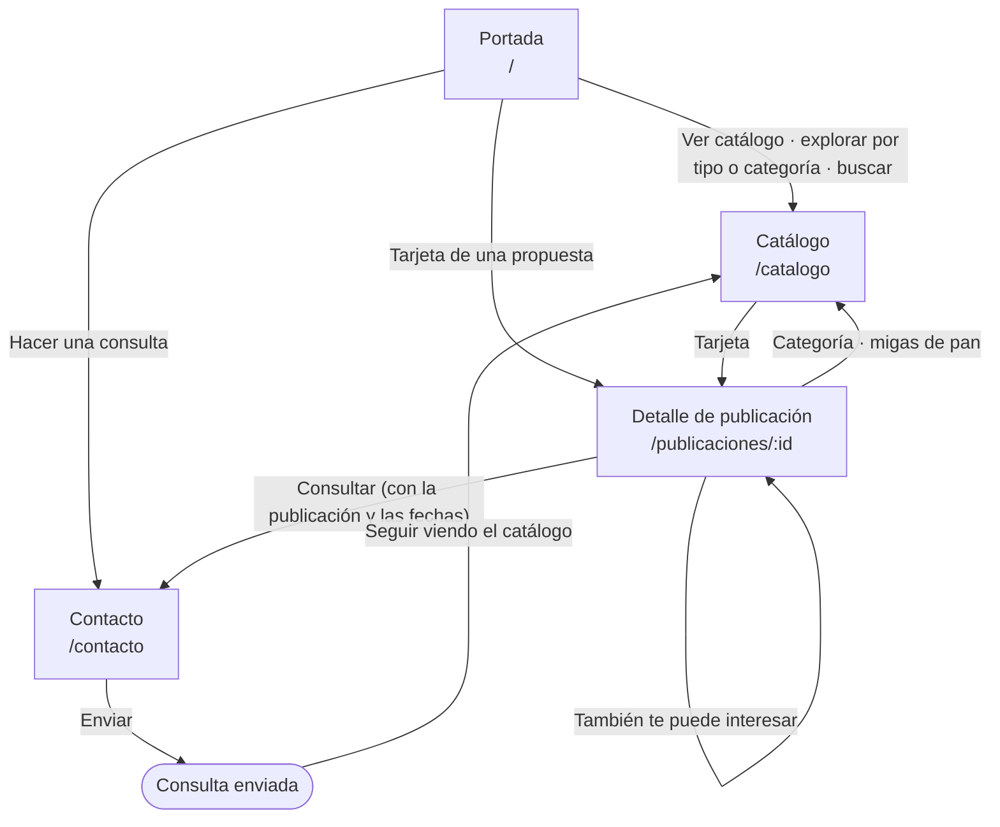
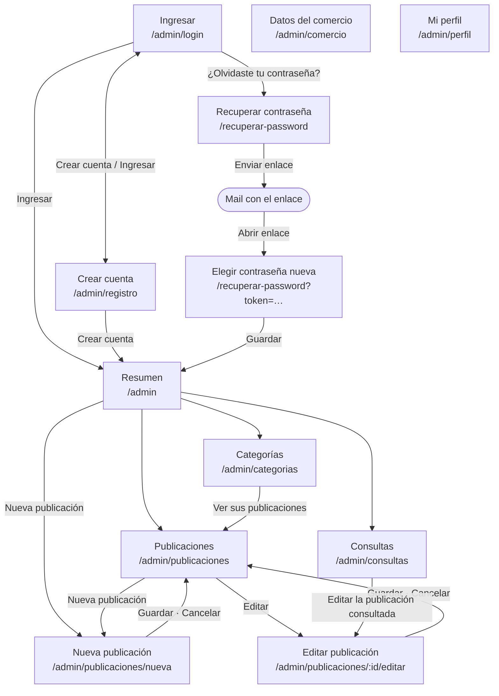

# Diagrama de navegación

El sistema tiene dos partes: el **sitio público**, de libre acceso, y el **panel de administración**, que requiere iniciar sesión. Las pantallas de acceso (ingresar, crear cuenta y recuperar contraseña) quedan entre las dos.

## Sitio público

Desde cualquier pantalla pública se puede ir a la portada, al catálogo filtrado por tipo y a contacto con la barra de navegación; el buscador de la cabecera lleva al catálogo con la búsqueda aplicada; y el botón flotante de ayuda lleva a contacto.

## Acceso y panel de administración

Dentro del panel, el menú lateral (o la barra superior en el celular) da acceso directo a Resumen, Publicaciones, Categorías, Consultas, Comercio y Perfil, y a «Ver el sitio». **Cerrar sesión** vuelve al ingreso.

Acciones que no cambian de pantalla:
- **Categorías:** el alta, la edición y la confirmación de borrado se abren en una ventana sobre la misma pantalla.
- **Consultas:** la consulta elegida se abre al lado de la lista (en el celular, en lugar de la lista) y queda en la dirección (`?ver=<id>`).
- **Publicaciones:** el borrado se confirma en una ventana sobre la lista.

## Protección de rutas

- Todas las rutas `/admin/*` salvo `/admin/login` y `/admin/registro` requieren sesión. Sin sesión, llevan al ingreso y, después de ingresar, vuelven a la pantalla pedida.
- Si la sesión vence mientras se usa el panel, el panel vuelve al ingreso.
- Una dirección que no existe muestra una página «No encontrada» con un botón para volver a la portada.
