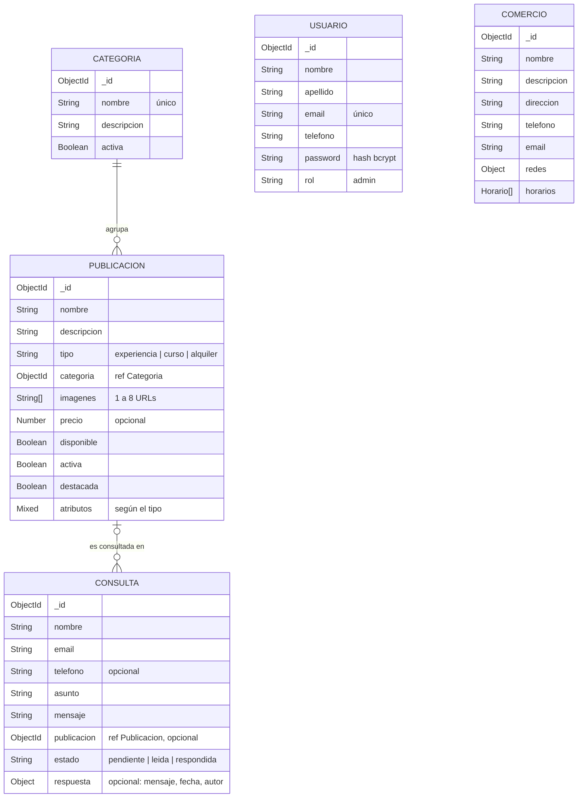

# Modelo de datos

La base es **MongoDB** y el acceso se hace con **Mongoose** (`backend/src/models/`). Además de los esquemas de Mongoose, cada pedido que llega a la API se valida con **Zod** (`backend/src/validaciones/`), donde están las reglas de formato y de largo.

Todas las colecciones guardan `createdAt` y `updatedAt` automáticamente.

## Diagrama

`Usuario` y `Comercio` no se relacionan con el resto: el usuario es quien administra y el comercio es la ficha institucional.

## Colecciones

### Categoria
Agrupa publicaciones y aparece como filtro en el catálogo.

| Campo | Tipo | Reglas |
|---|---|---|
| `nombre` | texto | obligatorio, único, 2 a 60 caracteres |
| `descripcion` | texto | opcional, hasta 300 caracteres (uso interno) |
| `activa` | booleano | por defecto `true`. Si es `false`, no aparece en los filtros del sitio |

No se puede borrar una categoría que tenga publicaciones (la API responde 409).

### Publicacion
Una experiencia, un curso o un equipo de alquiler.

| Campo | Tipo | Reglas |
|---|---|---|
| `nombre` | texto | obligatorio, 3 a 120 caracteres |
| `descripcion` | texto | obligatorio, 20 a 2000 caracteres |
| `tipo` | texto | `experiencia`, `curso` o `alquiler` |
| `categoria` | referencia a Categoria | obligatoria; la categoría tiene que existir |
| `imagenes` | lista de URLs | de 1 a 8 |
| `precio` | número | opcional, no negativo. Lo usan experiencias y cursos; sin precio, el sitio muestra «A consultar» |
| `disponible` | booleano | por defecto `true`. Lo que ve el visitante |
| `activa` | booleano | por defecto `true`. Si es `false`, la publicación no se ve en el sitio |
| `destacada` | booleano | por defecto `false` |
| `atributos` | objeto | su forma depende del `tipo` (ver abajo) |

**`atributos` según el tipo**

| Tipo | Campos |
|---|---|
| `experiencia` | `dificultad` (`baja`, `media`, `alta`), `duracionHoras` (> 0), `temporada` (al menos una de `verano`, `otonio`, `invierno`, `primavera`), `cupoMaximo` (entero > 0), `puntoEncuentro` (texto), `incluye` (lista de textos) |
| `curso` | `nivel` (`inicial`, `intermedio`, `avanzado`), `duracionHoras` (> 0), `cupo` (entero > 0), `certificacion` (texto opcional, hasta 120), `requisitosPrevios` (lista de textos) |
| `alquiler` | `precioPorDia` (≥ 0), `talles` (lista de textos), `unidadesTotales` (entero ≥ 0), `unidadesDisponibles` (entero ≥ 0, no más que las totales), `deposito` (opcional, ≥ 0) |

En la base, `atributos` es un campo de tipo mixto; la forma de cada tipo la garantiza la validación de la API (una unión discriminada por `tipo` en Zod). Así, en un solo modelo conviven tres tipos de publicación sin campos vacíos que no les correspondan.

### Consulta
Lo que envía un visitante desde el formulario de contacto.

| Campo | Tipo | Reglas |
|---|---|---|
| `nombre` | texto | obligatorio, 2 a 80 caracteres |
| `email` | texto | obligatorio, mail válido |
| `telefono` | texto | opcional, 6 a 30 caracteres |
| `asunto` | texto | obligatorio, 3 a 120 caracteres |
| `mensaje` | texto | obligatorio, 10 a 2000 caracteres |
| `publicacion` | referencia a Publicacion | opcional; se completa cuando la consulta sale del botón «Consultar» |
| `estado` | texto | `pendiente` (por defecto), `leida` o `respondida`. El administrador lo cambia a mano, y pasa solo a `respondida` al responder |
| `respuesta` | objeto | opcional: `mensaje`, `fecha` y `autor` de la respuesta enviada por mail desde el panel |

Las fechas que elige el visitante (alquiler o experiencia) viajan dentro del texto del mensaje.

### Usuario
Administradores del panel.

| Campo | Tipo | Reglas |
|---|---|---|
| `nombre`, `apellido` | texto | obligatorios, 2 a 60 caracteres |
| `email` | texto | obligatorio, único; se guarda en minúsculas |
| `telefono` | texto | obligatorio, 6 a 30 caracteres |
| `password` | texto | se guarda solo el hash (bcrypt). Mínimo 8 caracteres con al menos una letra y un número. Nunca sale en las respuestas de la API |
| `rol` | texto | `admin` |
| `resetToken`, `resetTokenExpira` | texto, fecha | para recuperar la contraseña. Se guarda el hash del token, que vence a los 60 minutos |

### Comercio
Ficha institucional. Es un **documento único**: no hay listado ni identificador en la API (`GET /comercio` y `PUT /comercio`).

| Campo | Tipo | Reglas |
|---|---|---|
| `nombre` | texto | obligatorio, 2 a 120 caracteres |
| `descripcion` | texto | obligatorio, 20 a 2000 caracteres |
| `direccion` | texto | obligatorio, 5 a 200 caracteres |
| `telefono` | texto | obligatorio, 6 a 30 caracteres |
| `email` | texto | opcional, mail válido |
| `redes` | objeto | `instagram`, `facebook` (hasta 120) y `whatsapp` (hasta 40), todos opcionales. Se guardan en la ficha, pero el sitio público no las muestra |
| `horarios` | lista de horarios | hasta 7, sin días repetidos |

Cada **horario** tiene `dia` (`lunes` … `domingo`, sin tildes), `cerrado` (booleano) y, si está abierto, `desde` y `hasta` en formato `HH:MM`, con el cierre posterior a la apertura.

## Datos de ejemplo

`npm run seed` (en `backend/`) vacía las colecciones y carga un juego de datos de ejemplo definido en `backend/src/seed/datos.js`: el comercio, un administrador, 5 categorías, 27 publicaciones (9 experiencias, 6 cursos y 12 equipos de alquiler) y 4 consultas. Antes de insertar, cada publicación se valida con el mismo esquema que usa la API. Las imágenes son URLs de fotos de Wikimedia Commons, elegidas para cada publicación (los lugares reales de Bariloche y el equipo de cada alquiler); autor y licencia de cada una en [`creditos-imagenes.md`](creditos-imagenes.md).

## Consultas al catálogo

`GET /publicaciones` combina la búsqueda por texto (`q`) con filtros por campos comunes (`tipo`, `categoria`, `disponible`, `destacada`, `precioMin`, `precioMax`) y, para el buscador avanzado, por campos de `atributos`:

| Parámetro | Busca en | Ejemplo |
|---|---|---|
| `dificultad` | `atributos.dificultad` (experiencias) | `dificultad=alta,media` |
| `temporada` | `atributos.temporada` (experiencias; alcanza con que coincida una) | `temporada=verano` |
| `nivel` | `atributos.nivel` (cursos) | `nivel=inicial` |

Cada parámetro acepta varios valores separados por coma, y los filtros se combinan entre sí.
